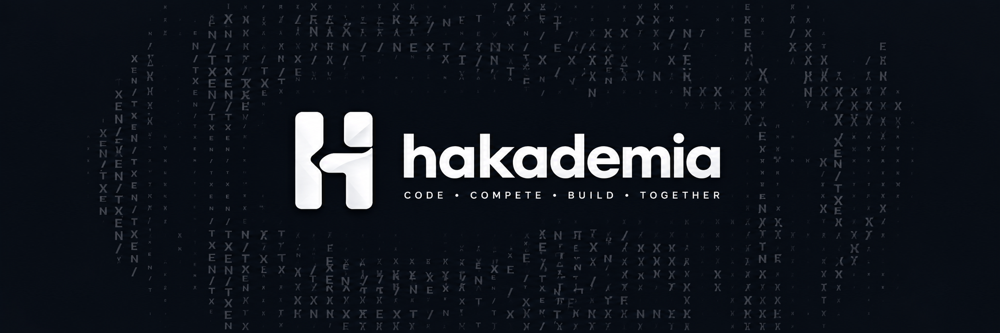

# Hakademia

**Build. Compete. Create.**

Hakademia is a developer-focused organization building tools, coding competitions, and an open-source ecosystem where developers can learn, experiment, collaborate, and create.

We believe great ideas deserve the opportunity to grow, and the people behind them deserve recognition.

## What We Do

### Coding Competitions
We build experiences where developers can challenge themselves, compete with others, and improve their problem-solving skills.

### Developer Ecosystem
We develop plugins, SDKs, integrations, and tools that extend the Hakademia platform and empower developers to build new experiences.

### Open Source & Community
We support community-driven projects, hackathons, and experiments. Members can build and share their work under Hakademia while receiving recognition for their contributions.

## Our Community

Hakademia is organized around three circles:

- **Core Team** — Building and maintaining the foundation of Hakademia.
- **Ecosystem Team** — Developing plugins, SDKs, integrations, and supporting tools.
- **Community Team** — Creating public projects, participating in hackathons, and contributing to open source.

We also welcome external contributors who want to collaborate on individual projects.

## Recognition Matters

Every project has a story, and every contributor matters.

We recognize original creators, maintainers, and contributors for the work they bring to Hakademia.

## Get Involved

Explore our public repositories, contribute to existing projects, or start building something new with the community.

**Hakademia — Built by developers, for developers.**
